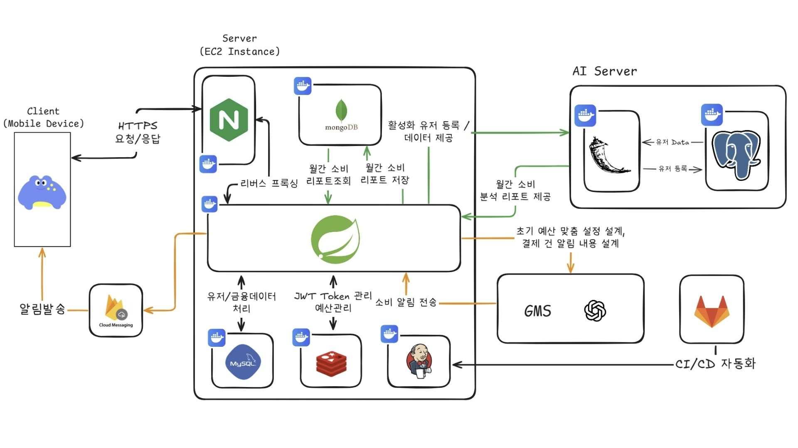
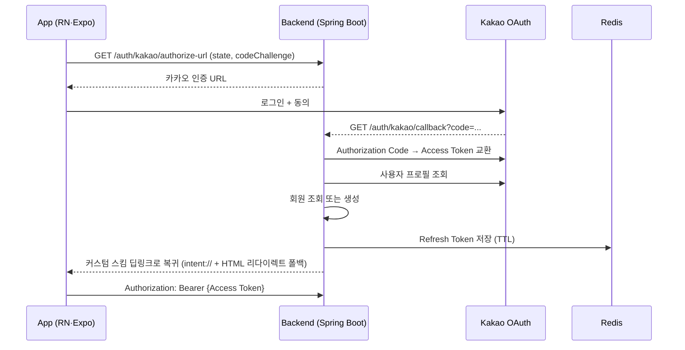
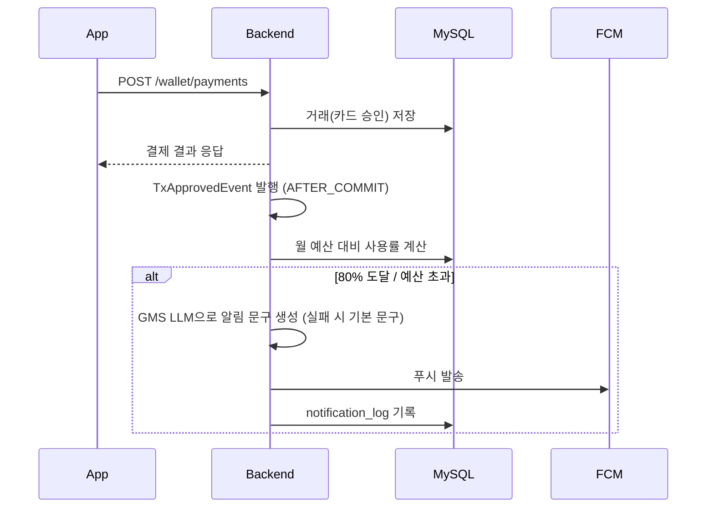
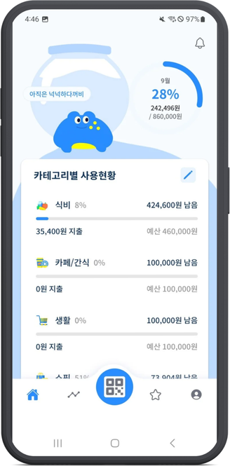
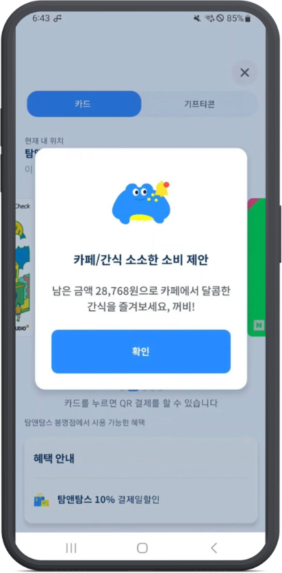
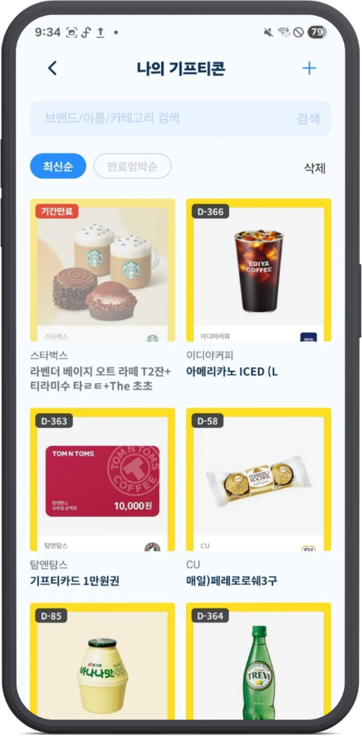
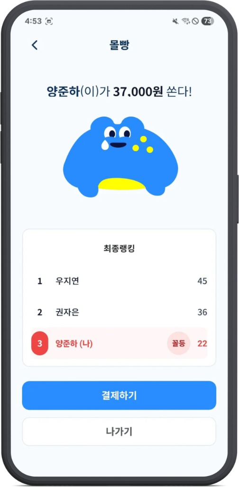

# 🐸 똑똑꺼비 (Toktokggubi)

<div align="center">
  
</div>

<div align="center">


</div>

> 예산 관리와 AI 소비 코칭, interactive 소비 제안을 통해 과소비를 예방하고 혜택을 최적화하여 사용자의 건전한 소비 습관을 만들어주는 서비스

## 프로젝트 개요

| 구분 | 내용 |
|------|------|
| 프로젝트 | SSAFY 13기 특화 PJT (핀테크 도메인) |
| 기간 | 2025.08.25 ~ 09.26 (5주) |
| 인원 | 6명 (FE 3, BE 2, Infra/AI 1) |
| 성과 | 특화 PJT 우수상 1등 |

## 서비스 소개

똑똑꺼비는 AI 기반의 개인 맞춤형 예산 관리 및 소비 코칭 서비스입니다. 사용자의 소비 패턴을 분석하여 예산을 자동으로 추천하고, 실시간 알림과 월간 리포트를 통해 건전한 소비 습관을 형성하도록 돕습니다.

### 핵심 가치

1. **AI 기반 맞춤형 예산 추천**: 사용자의 소비 패턴을 분석하여 개인화된 예산안을 제안
2. **실시간 소비 코칭**: 현재 상황에 맞는 즉각적인 알림과 주기적인 코칭 리포트 제공
3. **Interactive 소비 제안**: 흔들기 등 사용자 행동을 통한 최적의 소비 제안 확인
4. **통합 혜택 관리**: 흩어진 카드 혜택과 기프티콘을 한 곳에서 관리하고 최적 사용 시점 안내
5. **게이미피케이션**: 친구와의 몰빵 등 재미 요소를 결합한 소비 관리

### 앱 화면 구성

하단 5개 탭을 중심으로 구성된 React Native(Expo Router) 앱입니다.

| 탭 | 화면 | 주요 내용 |
|------|------|------|
| 홈 | `app/(tabs)/home` | 이번 달 예산 사용률(원형 게이지), 카테고리별 사용 현황, 최근 거래 내역 |
| 리포트 | `app/(tabs)/report` | AI 월간 소비 리포트, 이상 소비 탐지, 카테고리별 지출 차트·결제 내역 |
| 결제 | `app/(tabs)/payment` | 흔들기 기반 주변 장소·최적 카드 제안, QR 스캔 결제 |
| 럭키 | `app/(tabs)/lucky` | 브랜드별 세일 정보 캘린더, N빵 계산기, 몰빵 대결 |
| 마이페이지 | `app/(tabs)/mypage` | 프로필·월 소득, 내 카드, 내 기프티콘, 설정 |

## 시스템 아키텍처



### 아키텍처 구성 요소

**Client (Mobile Device)**
- React Native(Expo SDK 53) 기반 모바일 앱
- HTTPS를 통한 서버와의 요청/응답
- Firebase Cloud Messaging을 통한 알림 수신
- 카카오 로컬 API 기반 주변 장소 조회, 커스텀 스킴(`toktokggubi://`) 딥링크로 로그인 복귀

**Server (EC2 Instance)**
- **Nginx**: 리버스 프록시 (`/api/` → Spring Boot, `/ai/` → Flask AI 서버)
- **Main Application Logic**: 핵심 비즈니스 로직 처리
  - JWT Token 관리
  - 예산 관리
  - 유저/금융 데이터 처리
  - 카드·기프티콘·혜택 관리
  - STOMP 기반 실시간 대결(몰빵)
- **MySQL**: 유저/금융/예산/카드 데이터 저장
- **Redis**: JWT Refresh Token, 로그아웃 블랙리스트, 예산 작성 초안 캐싱
- **MongoDB**: 월간 소비 리포트(`aiUserReport`) 저장 및 조회
- **Jenkins**: CI/CD 자동화

**AI Server**
- 사용자별 ML 모델 학습 및 관리
- 월간 소비 분석 리포트 생성
- 초기 예산 맞춤 설정 설계
- 결제 건 알림 내용 설계
- **PostgreSQL**: AI 서버가 참조하는 사용자·거래 메타데이터

**External Services**
- **Cloud Messaging (FCM)**: 푸시 알림 발송
- **GMS**: 알림 문구·예산 코멘트 생성용 LLM 프록시(OpenAI)
- **Google Cloud Vision**: 기프티콘 이미지 OCR
- **Kakao OAuth / Kakao Local**: 소셜 로그인, 주변 장소 검색
- **SSAFY Finance OpenAPI**: 계좌·카드·거래 내역 수집

### 인증 흐름 (카카오 로그인 + 딥링크)



### 결제 → 예산 알림 흐름



## 주요 기능

### 서비스 화면

| 홈 · 이번 달 예산 현황 | 흔들기 · AI 소비 제안 |
|:---:|:---:|
|  |  |

| 기프티콘 목록 | 몰빵 결과 |
|:---:|:---:|
|  |  |

### 1. 예산 관리

- **초기 예산 설정**: 월소득 정보를 통한 AI 기반 전체/카테고리별 예산 제안
- **자동 예산 설정**: 매월 1일 12시(KST) 스케줄러가 이전 달 소비 내역을 기반으로 예산을 재추천·저장
- **작성 초안**: 총액 → 고정지출 → 카테고리 순서로 3단계 저장(`/budget/draft/save/*`)하며 Redis에 30분간 임시 보관, `POST /budget/commit`으로 확정
- **실시간 예산 현황**: 카테고리별 사용 현황과 남은 예산 조회(`/budget/total`, `/budget/category`)

### 2. 소비 내역 조회

- **거래 내역 수집**: SSAFY 금융 OpenAPI 연동(`POST /finance/collect`)으로 계좌·카드·승인 거래 동기화
- **카테고리별 분석**: 거래를 대분류 카테고리로 매핑하고 월/카테고리 단위로 집계(`/transaction/summary`, `/transaction/summary/category`)
- **월간 리포트**: 상세한 소비 분석과 개선 제안

### 3. AI 소비 코칭

- **실시간 알림**
  - 전체/카테고리 예산 80% 도달 시 알림
  - 예산 초과 시 알림 (초과 알림이 있으면 80% 알림은 중복 발송하지 않음)
  - 현재 위치한 장소의 카테고리 기준 남은 예산 안내(`POST /push/location`)
  - GMS LLM이 사용자 상황에 맞는 문구를 생성하고, 실패 시 기본 문구로 대체
- **월간 리포트**
  - AI 이상 소비 탐지 결과
  - 월간 소비 한마디 (LLM 기반)
  - 월간 지출 요약 및 지출 내역

### 4. Interactive 소비 제안

- **흔들기 기능**
  - 가속도계(`expo-sensors`) + 저역 통과 필터로 흔들림 감지 (임계값·연속 횟수·쿨다운)
  - 해당 장소 최적의 결제 수단 제안 (카드 혜택 랭킹, `/wallet/cards/best`)
  - 주변 장소 조회(카카오 로컬 API)와 카드 혜택 비교
  - 해당 카테고리 사용 가능 예산 알림
- **QR 결제**
  - 앱 카메라로 QR 스캔(`app/pay/qr-scanner.tsx`) 후 결제 요청
  - 서버는 ZXing으로 QR PNG 생성 API(`GET /qr/payment`)도 제공

### 5. 혜택 & 기프티콘 관리

- **카드 관리**
  - 보유 카드 목록 및 카드별 혜택 조회(`/wallet/cards`)
  - 카드 상품·카드사·프랜차이즈 혜택 데이터 기반 관리
- **기프티콘 관리**
  - 이미지 한 장으로 등록: Google Cloud Vision OCR → 텍스트 파서가 브랜드·상품명·만료일 추출 → 프랜차이즈 매칭 후 저장
  - 기프티콘 목록 조회(최신순·만료임박순 정렬, 사용 가능 여부 필터) 및 삭제, 만료 D-Day 표시
- **세일 정보 달력**: 브랜드별 할인 정보 및 이벤트 캘린더(`/sale-events/month`, `/sale-events/period`)

### 6. 게이미피케이션

- **N빵**: 함께 쓴 비용을 공평하게 분할하는 계산기
- **몰빵**: 한 명이 전부 지불하는 재미있는 대결 게임
  - WebSocket(STOMP) 기반 실시간 대결 (`/topic/molbbang.{roomCode}`)
  - 방 생성 → 참여 → Ready → 시작 → 점수 제출 → 결과 집계
  - 흔들기 배틀로 점수 경쟁
  - 친구와 함께하는 소셜 기능

## 기술 스택

### Frontend

| 구분 | 사용 기술 |
|------|------|
| Framework | React Native 0.79.5, Expo SDK 53, React 19 |
| Language | TypeScript |
| Navigation | Expo Router 5 |
| State Management | Zustand 5 (전역), TanStack React Query 5 (서버 상태) |
| API Client | Axios, Zod (응답 스키마 검증) |
| Realtime | `@stomp/stompjs` (몰빵 WebSocket) |
| UI | Custom Components, Reanimated, Lottie, Gorhom Bottom Sheet |
| Maps / Location | React Native Maps, Expo Location, 카카오 로컬 API |
| Camera / Sensor | Expo Camera, Expo Sensors (Accelerometer) |
| Push Notifications | `@react-native-firebase/app`, `@react-native-firebase/messaging` |
| Auth | 카카오 OAuth2 + 커스텀 스킴 딥링크, Expo SecureStore |

### Backend

| 구분 | 사용 기술 |
|------|------|
| Framework | Spring Boot 3.5.5 |
| Language | Java 17 (Gradle toolchain) |
| Build | Gradle |
| Database | MySQL 8.0 (JPA/Hibernate), MongoDB (Spring Data MongoDB) |
| Cache / Token | Redis (Spring Data Redis) |
| Security | Spring Security, Spring Security Messaging, JJWT 0.11.5 |
| WebSocket | Spring WebSocket + STOMP (`spring-messaging`) |
| API Documentation | springdoc-openapi 2.8.9 (Swagger UI) |
| HTTP Client | Spring WebFlux `WebClient` |
| OCR | Google Cloud Vision API 3.49.0 (대안: Tess4J) |
| QR | ZXing 3.5.3 |
| Push | Firebase Admin SDK 9.5.0 (FCM) |
| LLM | GMS 프록시 경유 OpenAI Chat Completions (`openai-java` 3.0.3, `gpt-4o-mini`) |
| 기타 | Spring Boot Actuator, Lombok, Apache Tika |

### AI Service

| 구분 | 사용 기술 |
|------|------|
| Framework | Flask 3.1.2 |
| Language | Python 3.11 |
| ML | TensorFlow 2.20.0 (Keras), scikit-learn 1.7.2 |
| 모델 | AutoEncoder(이상 탐지), Isolation Forest(이상 탐지) |
| LLM | Hugging Face Transformers 4.56.1 / `huggingface_hub` (기본 `EleutherAI/polyglot-ko-1.3b`, `LLM_PROVIDER`로 `huggingface-api`·`openai` 등 전환) |
| 데이터 처리 | Pandas, NumPy |
| Scheduling | APScheduler 3.11.0 |
| Metadata DB | PostgreSQL (psycopg2) |

### Infrastructure

| 구분 | 사용 기술 |
|------|------|
| Containerization | Docker, Docker Compose (`compose.yml`, `compose.dev.yml`, `compose.prod.yml`, `compose.ai.yml`) |
| Web Server | Nginx (리버스 프록시, HTTPS) |
| Database | MySQL 8.0, MongoDB, Redis, PostgreSQL(AI 서버) |
| Message Broker | RabbitMQ (compose 구성) |
| CI/CD | Jenkins (lts-jdk21) |
| Monitoring | Spring Boot Actuator (`/actuator/health`) |

## 프로젝트 구조

```
toktokggubi/
├── frontend/                        # React Native(Expo) 앱
│   ├── app/                         # Expo Router 페이지 (파일 기반 라우팅)
│   │   ├── (tabs)/                  # 하단 탭 (home, report, payment, lucky, mypage)
│   │   ├── auth/                    # 로그인·회원가입·개인정보 입력
│   │   ├── budget/                  # 예산 설정(총액·고정지출·카테고리)
│   │   ├── cards/                   # 카드 등록·조회
│   │   ├── gifticons/               # 기프티콘 등록·목록
│   │   ├── pay/                     # 결제·QR 스캔
│   │   ├── nbbang/                  # N빵
│   │   ├── molbbang/                # 몰빵 방 생성·참여·대결
│   │   ├── report/                  # 월간 리포트
│   │   ├── notification/            # 알림 목록
│   │   └── user/                    # 프로필·설정
│   ├── src/
│   │   ├── features/                # 기능별 모듈 (api/model/screens/templates/ui)
│   │   │   ├── Auth/
│   │   │   ├── Budget/
│   │   │   ├── Home/
│   │   │   ├── Lucky/               # 세일 캘린더, N빵, 몰빵
│   │   │   ├── Notification/
│   │   │   ├── Pay/
│   │   │   ├── Report/
│   │   │   └── User/                # 카드·기프티콘·프로필
│   │   ├── shared/                  # api, components, hooks, services, theme, types, ui, utils
│   │   ├── assets/                  # 이미지·폰트
│   │   └── types/
│   ├── app.config.js               # Expo 앱 설정 (딥링크 스킴·FCM 플러그인)
│   └── package.json
├── backend/                         # Spring Boot 서버
│   ├── src/main/java/com/ssafy/toktokggubi/
│   │   ├── domain/                  # 도메인별 패키지
│   │   │   ├── auth/                # 카카오 OAuth2
│   │   │   ├── user/                # 회원·프로필
│   │   │   ├── budget/              # 예산 초안·확정·자동 추천
│   │   │   ├── transaction/         # 거래·카테고리 집계
│   │   │   ├── finance/             # SSAFY 금융 OpenAPI 연동
│   │   │   ├── wallet/              # 보유 카드·결제
│   │   │   ├── card/                # 카드 상품·혜택
│   │   │   ├── category/            # 소비 카테고리
│   │   │   ├── franchise/           # 프랜차이즈
│   │   │   ├── merchant/            # 가맹점
│   │   │   ├── gifticon/            # 기프티콘 OCR·파싱
│   │   │   ├── sale/                # 세일 이벤트 캘린더
│   │   │   ├── report/              # AI 월간 리포트
│   │   │   ├── notification/        # 알림 로그·설정
│   │   │   ├── push/                # 예산 임계 푸시(FCM)
│   │   │   ├── molbbang/            # 몰빵 대결
│   │   │   └── gms/                 # GMS LLM 연동
│   │   ├── global/                  # security, ws, ocr, payment(QR), file, dto, exception
│   │   └── config/                  # Security, WebSocket, Redis, FCM, Swagger 등
│   ├── src/main/resources/
│   │   ├── application.properties   # 공통 설정(환경변수 기반)
│   │   ├── application-dev.properties
│   │   ├── application-prod.properties
│   │   └── toktokggubi_ddl.sql      # MySQL 스키마
│   └── build.gradle
├── ai/                              # AI 서버 (Flask)
│   ├── app.py                       # 분석 API·스케줄러 엔트리포인트
│   ├── model.py                     # 사용자별 모델 저장·로드
│   ├── model_functions/
│   │   ├── ae_functions.py          # AutoEncoder 학습·추론
│   │   └── it_functions.py          # Isolation Forest 학습·추론
│   ├── reports.py                   # 월간 리포트 JSON 생성
│   ├── llm.py                       # LLM 프로바이더 초기화·호출
│   ├── external_request.py          # 백엔드 거래 데이터 조회
│   ├── db.py                        # PostgreSQL 연결
│   └── requirements.txt
├── database/
│   ├── init.sql                     # PostgreSQL 초기 스키마
│   └── mongodb/init-mongo.js        # MongoDB 초기화
├── data/                            # 카드 상품·혜택 수집 스크립트와 시드 데이터
├── docs/                            # 아키텍처 문서·이미지
├── exec/                            # 빌드/배포 산출물 (포팅 매뉴얼, DML, env 예시)
├── nginx/                           # Nginx 설정 (dev/prod)
└── compose*.yml                     # Docker Compose 파일
```

## 데이터베이스

### MySQL (핵심 테이블)

`backend/src/main/resources/toktokggubi_ddl.sql` 기준 22개 테이블로 구성됩니다.

| 영역 | 테이블 |
|------|------|
| 사용자 | `user`, `user_notification_setting`, `device_push_token` |
| 예산 | `user_monthly_budget`, `budget_category`, `user_selected_category`, `fixed_expense` |
| 소비 | `category`, `card_transaction`, `franchise`, `merchant` |
| 카드 | `card_issuer`, `card_product`, `card_product_benefit`, `user_card`, `user_account` |
| 혜택 | `gifticon`, `sale_event` |
| 알림 | `notification_log` |
| 게이미피케이션 | `molbbang_room`, `molbbang_member`, `molbbang_score` |

### MongoDB

- `aiUserReport`: AI 서버가 생성한 월간 리포트(`userInfo`, `summaryReport`, `spendingDetails`)

### PostgreSQL (AI 서버)

- 사용자·거래 메타데이터 원본 조회용 (`database/init.sql`)

## 실행 방법

### 사전 요구사항

- Java 17
- Node.js 18+ (Expo SDK 53)
- Python 3.11
- Docker & Docker Compose v2
- MySQL 8.0, Redis, MongoDB (Docker Compose로 함께 기동)

### 1. 환경 변수 준비

프로젝트 루트에 `.env` 파일을 만들고 아래 항목을 채웁니다. (값은 커밋하지 않습니다. 항목별 상세 설명은 `exec/B207_PORTING_MANUAL.md` 참고)

| 구분 | 변수 |
|------|------|
| 데이터베이스 | `MYSQL_DATABASE`, `MYSQL_USER`, `MYSQL_PASSWORD`, `MYSQL_ROOT_PASSWORD` |
| MongoDB | `MONGO_ROOT_USERNAME`, `MONGO_ROOT_PASSWORD`, `MONGO_DATABASE`, `MONGO_HOST`, `MONGO_PORT` |
| Redis | `REDIS_HOST`, `REDIS_PORT` |
| RabbitMQ | `RABBITMQ_DEFAULT_USER`, `RABBITMQ_DEFAULT_PASS`, `RABBITMQ_HOST`, `RABBITMQ_PORT` |
| 애플리케이션 | `SPRING_PORT`, `SPRING_PROFILES_ACTIVE` |
| JWT | `JWT_SECRET`, `JWT_ISSUER`, `SIGNUP_EXP_MINUTES`, `ACCESS_EXP_MINUTES`, `REFRESH_EXP_DAYS` |
| 외부 API | `FINANCE_BASE_URL`, `FINANCE_API_KEY`, `GMS_API_KEY`, `KAKAO_CLIENT_ID`, `KAKAO_REST_KEY`, `OPENAI_API_KEY` |
| 인증 파일 경로 | `GOOGLE_APPLICATION_CREDENTIALS`, `FCM_CREDENTIALS_LOCATION`, `FCM_ENABLED` |

AI 서버는 `ai/.env`에 `DB_HOST`, `POSTGRES_DB`, `POSTGRES_USER`, `POSTGRES_PASSWORD`, `LLM_PROVIDER`, `LLM_MODEL_NAME`, `HF_TOKEN`을 설정합니다.

### 2. 백엔드·인프라 기동

```bash
docker compose -f compose.yml -f compose.prod.yml -f compose.ai.yml up -d --build
docker compose logs -f backend
```

기동 순서는 `mysql`·`mongodb`·`redis`·`rabbitmq` → `backend` → `ai` → `nginx`입니다.

### 3. 프론트엔드 실행

```bash
cd frontend
npm install
npx expo start        # Expo Go 또는 개발 빌드로 실행
```

`app.config.js`에 API 주소·카카오 키 등 `EXPO_PUBLIC_*` 환경 변수를 설정합니다.

### 4. 확인

| 대상 | 경로 |
|------|------|
| 백엔드 헬스 체크 | `GET /api/actuator/health` |
| API 문서(Swagger UI) | `/api/swagger-ui/index.html` |
| OpenAPI 스펙 | `/api/v3/api-docs` |
| AI 서버 | `POST /ai/analyze`, `POST /ai/model`, `POST /ai/transaction/anomaly` |

## AI 모델

### 이상 소비 탐지

- **AutoEncoder**: 사용자 소비 패턴을 학습하고 재구성 오차(MSE) 상위 5%를 이상치로 판정
- **Isolation Forest**: `contamination=0.15`, `n_estimators=200`으로 통계적 이상치 탐지
- **결합**: 두 모델의 탐지 결과를 병합하고 중복 거래를 제거해 리포트에 반영, 단건 판정 시에는 두 모델 중 하나라도 이상이면 이상 거래로 처리

### 예산 추천

- **LLM 기반**: GMS 프록시(OpenAI `gpt-4o-mini`)로 자연어 예산 코멘트·카테고리 조정안 생성
- **패턴 분석**: 이전 달 소비 데이터 기반 예산 조정
- **스케줄링**: 매월 1일 12시(KST) 백엔드 스케줄러가 전 사용자 예산을 재추천, 매월 1일 0시 AI 서버 스케줄러가 월간 리포트 생성

### 개인화

- **사용자별 모델**: 사용자마다 별도의 AutoEncoder(`.keras`)·Isolation Forest(`.joblib`) 모델 저장
- **지속적 학습**: 신규 사용자는 1년치 데이터로 학습, 이후 매월 이전 달 데이터로 재학습

## 설계 포인트

구현 코드에 드러난 설계 판단을 정리했습니다.

| 주제 | 내용 |
|------|------|
| 예산 작성 초안 | 총액·고정지출·카테고리를 단계별로 저장하되 Redis에 30분 TTL 스냅샷으로 보관하고, 확정 시점에 한 번에 MySQL에 반영해 부분 저장 상태를 남기지 않음 |
| 알림 중복 방지 | 같은 달에 초과 알림이 이미 있으면 80% 알림을 보내지 않고, 사용률이 100% 이상이면 80% 알림을 건너뜀 |
| 결제와 알림 분리 | 결제 트랜잭션 커밋 이후(`@TransactionalEventListener(AFTER_COMMIT)`)에 예산 알림을 계산하며, 알림 실패는 로그만 남겨 결제 응답에 영향을 주지 않음 |
| LLM 실패 대응 | GMS 응답이 없거나 오류면 카테고리·남은 금액 기반 기본 문구로 대체 |
| OCR 파이프라인 | Vision API는 텍스트 추출만 담당하고, 브랜드·상품명·만료일 정형화는 `GifticonTextParser`가 맡아 책임을 분리. 교환처 영역 우선 탐색 → 별칭·캐노니컬 사전 → 금지어·로고·바코드 필터 순으로 브랜드를 확정 |
| 기프티콘 판정 | OCR 텍스트의 키워드·바코드 패턴 점수로 기프티콘 이미지 여부를 먼저 판정한 뒤 파싱 |
| 딥링크 복귀 | 커스텀 스킴과 `intent://`를 함께 두고, 브라우저에 남는 경우를 대비해 HTML 리다이렉트 폴백 제공 |
| 토큰 관리 | Access/Refresh를 분리하고 Refresh는 Redis에 TTL로 저장. 로그아웃 시 Refresh 삭제 + Access 블랙리스트 등록(TTL은 Access 만료 시간) |
| 실시간 대결 | 방 코드별 STOMP 토픽(`/topic/molbbang.{roomCode}`)으로 상태를 브로드캐스트하고, WebSocket 핸드셰이크·채널 인터셉터에서 JWT를 검증 |
| 흔들기 감지 | 가속도계 샘플링(50ms) + 저역 통과 필터로 중력 성분을 제거하고, 임계값·연속 횟수·판정 시간창·쿨다운으로 오탐과 중복 트리거를 억제 |

## 팀 구성

| 이름 | 역할 | 담당 |
|------|------|------|
| 이하연 | 팀장, FE | 프론트엔드 개발, 프로젝트 관리 |
| 권자은 | FE | 프론트엔드 개발 |
| 안덕현 | FE | 프론트엔드 개발 |
| 우지연 | BE | 백엔드 개발, 인프라 |
| 양준하 | BE | 백엔드 개발 |
| 허정현 | Infra, AI | AI 모델 개발, 인프라 구축 |

## 추후 개선 방향

- **알림·리포트 비동기 처리**: 현재 예산 알림은 결제 커밋 이후 동기로 계산됩니다. compose에 구성된 RabbitMQ를 활용해 알림·리포트 생성을 메시지 기반으로 분리하면 결제 응답 시간과 알림 실패 격리를 함께 개선할 수 있습니다.
- **테스트 보강**: 현재는 애플리케이션 컨텍스트 로드 테스트 중심이라, 예산 계산·알림 임계 판정·OCR 파싱 규칙에 대한 단위 테스트를 추가할 계획입니다.
- **AI 모델 운영**: 사용자별 모델 파일을 서버 로컬 디스크에 보관하고 있어, 모델 저장소 분리와 버전 관리로 재학습·롤백 절차를 정리할 수 있습니다.
- **토큰 재사용 감지**: 리프레시 토큰 재발급 시 이전 토큰 재사용을 감지해 세션 전체를 무효화하는 정책을 보완할 수 있습니다.
- **기프티콘 브랜드 인식 확장**: 캐노니컬 사전에 등록되지 않은 브랜드는 원문 표기를 그대로 사용하므로, 별칭 사전 확장과 유사도 기반 매칭을 추가할 수 있습니다.
- **관측성**: Actuator health 외에 예산 알림 발송·리포트 생성 지표를 수집해 운영 상태를 확인할 수 있도록 확장할 계획입니다.

---

**똑똑꺼비**와 함께 스마트한 소비 습관을 만들어보세요!
